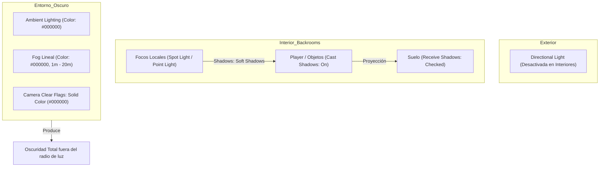
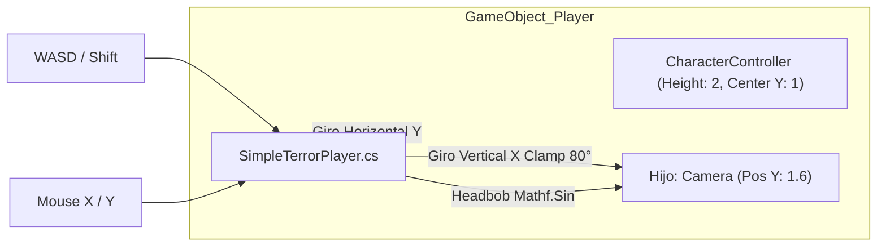

# Documentación Técnica del Proyecto: CUBE_Backrooms

**Versión del Motor:** Unity 6 (6000.3.24f1 LTS)  
**Render Pipeline:** Universal Render Pipeline (URP)  
**Rama Git Activa:** `feature/fase-2-interaccion-audio` (Base: `main`)

---

## 1. Fase 1: Iluminación, Sombras y Atmósfera de Terror

### 1.1. Diagnóstico de Sombras en Interiores
* **Comportamiento inicial:** La luz direccional (`Directional Light`) proyectaba sombra afuera del cuarto, pero adentro el cubo no proyectaba sombras.
* **Causa Física:** El techo del laberinto (`Mat_techo` con `Cast Shadows: On`) actúa como una barrera sólida que bloquea los rayos de la fuente de luz exterior infinita (sol).
* **Solución técnica:**
  1. En interiores tipo Backrooms, las sombras deben provenir de luminarias locales (`Spot Light` y `Point Light`).
  2. En el Inspector de cada luz: cambiar `Shadows > Shadow Type` de `No Shadows` a **`Soft Shadows`** (o `Hard Shadows`).
  3. En el objeto `suelo`, verificar en `Mesh Renderer > Lighting` que **`Receive Shadows`** esté activo ($\checkmark$).

### 1.2. Atmósfera de Oscuridad Total (Terror)
Para eliminar el lavado grisáceo y lograr que las zonas sin luz fueran 100% negras:
1. **Environment Lighting:**
   * Menú: `Window > Rendering > Lighting > pestaña Environment`.
   * `Skybox Material`: Configurado en **`None`** (se retiró el material incompatible que generaba tintes morados/magenta).
   * `Source`: **`Color`**.
   * `Ambient Color`: **Negro absoluto `(0, 0, 0)`**.
2. **Niebla Lineal (Fog):**
   * `Fog`: Habilitado ($\checkmark$).
   * `Color`: Negro puro `(0, 0, 0)`.
   * `Mode`: `Linear` (`Start: 1m`, `End: 15m - 25m`).
3. **Fondo de Cámara (Camera Clear Flags):**
   * En el componente `Camera`: `Background Type` en **`Solid Color`**, color en **Negro Puro**. Esto erradicó el horizonte azul celeste por defecto de Unity al terminar las paredes.

### 1.3. Script de Parpadeo y Apagones (`HorrorFlickerLight.cs`)
* **Ubicación:** [`Assets/Scripts/HorrorFlickerLight.cs`](file:///home/jher/Documentos/SEMESTRE%20VI/PROGRAMACION%20DE%20VIDEOJUEGOS/UNITY/JUEGO_3D/Backrooms/CUBE_Backrooms/Assets/Scripts/HorrorFlickerLight.cs)
* **Comportamiento:**
  * **Micro-parpadeos erráticos:** Corrutina que altera la intensidad cada `0.04s - 0.15s` de forma no periódica.
  * **Apagones totales (Blackouts):** Chispazos previos seguidos de apagado total a `0` durante `1s - 3.5s`.
  * **Sincronización emisiva:** Desactiva dinámicamente la propiedad `_EmissionColor` del material de la lámpara (`Mat_luz`) para que el foco físico no quede flotando blanco a oscuras.

---

## 2. Fase 1: Cámara y Post-Procesado Estilo VHS

Se implementaron dos capas superpuestas para obtener la estética de cámara de video analógica de los años 90:

### 2.1. Capa de Volume Profile (URP Nativo)
Configurado en: [`Assets/Scenes/ESCENA_JUEGO/Global Volume_camaraVHS Profile.asset`](file:///home/jher/Documentos/SEMESTRE%20VI/PROGRAMACION%20DE%20VIDEOJUEGOS/UNITY/JUEGO_3D/Backrooms/CUBE_Backrooms/Assets/Scenes/ESCENA_JUEGO/Global%20Volume_camaraVHS%20Profile.asset)
* **Chromatic Aberration:** `0.7` (dispersión prismática en los márgenes de la lente).
* **Film Grain:** `Type: Large 01`, `Intensity: 0.3` (ruido granulado de cinta).
* **Vignette:** `Intensity: 0.488`, `Smoothness: 0.278` (oscurecimiento en los bordes de pantalla CRT).
* **Bloom:** `Intensity: 2.0`, `Threshold: 1.0` (resplandor de los fluorescentes).
* **Tonemapping:** Modo **`ACES`** (contraste cinematográfico con negros profundos).

### 2.2. Capa de Shader Blit Personalizado (Post-Process Feature)
* **Shader:** [`Assets/Shaders/URP_VHS_Retro.shader`](file:///home/jher/Documentos/SEMESTRE%20VI/PROGRAMACION%20DE%20VIDEOJUEGOS/UNITY/JUEGO_3D/Backrooms/CUBE_Backrooms/Assets/Shaders/URP_VHS_Retro.shader)
* **Material:** `Assets/Shaders/M_VHS_Retro.mat`
* **Integración:** Agregado a [`Assets/Settings/PC_Renderer.asset`](file:///home/jher/Documentos/SEMESTRE%20VI/PROGRAMACION%20DE%20VIDEOJUEGOS/UNITY/JUEGO_3D/Backrooms/CUBE_Backrooms/Assets/Settings/PC_Renderer.asset) como `Full Screen Pass Renderer Feature`.
* **Efectos Procesados en el Shader:**
  1. *Scanlines*: Ondas senoidales oscuras horizontales.
  2. *Tape Jitter / Glitch*: Deformación horizontal reactiva al tiempo `_Time.y`.
  3. *RGB Color Bleed*: Muestreo desfasado en canales R y B del buffer `_BlitTexture`.
  4. *Static Noise*: Grano analógico generado mediante algoritmo pseudo-aleatorio `hash12`.

---

## 3. Fase 2: Controlador del Jugador en Primera Persona (FPS)

### 3.1. Arquitectura y Código Básico (`SimpleTerrorPlayer.cs`)
* **Ubicación:** [`Assets/Scripts/SimpleTerrorPlayer.cs`](file:///home/jher/Documentos/SEMESTRE%20VI/PROGRAMACION%20DE%20VIDEOJUEGOS/UNITY/JUEGO_3D/Backrooms/CUBE_Backrooms/Assets/Scripts/SimpleTerrorPlayer.cs)
* **Líneas de código:** Menos de 90 líneas, enfocado en simplicidad y conceptos estándar de Unity:
  * **Rotación de Visión:** `Input.GetAxis("Mouse X/Y")`, `Mathf.Clamp` en `[-80°, 80°]` en la cámara para evitar vuelcos, y `transform.Rotate` en el cuerpo.
  * **Inercia Humana:** `Vector3.Lerp` para acelerar y desacelerar con peso corporal realista (evita arranques y paradas bruscas robóticas).
  * **Caminar / Correr:** Velocidad de paso (`2.8 m/s`) y sprint con `Left Shift` (`5.0 m/s`).
  * **Gravedad:** Control sobre `controller.isGrounded` con fuerza descendente constante (`-2f`) para mantenerse firme sobre el suelo.
  * **Headbob (Balanceo de pasos):** `Mathf.Sin(timer)` aplicado a la posición local Y de la cámara para transmitir la sensación física de pasos al caminar.
  * **Gestión de Cursor:** `Cursor.lockState = CursorLockMode.Locked` al iniciar, con liberación condicional mediante tecla `Escape`.

### 3.2. Solución al Bloqueo/Congelamiento Inicial
* **Problema:** Al dar Play, el jugador no se movía ni respondía.
* **Causa:** El `CharacterController` tenía `Center Y = 0` y posición `Y = -0.169`, lo que incrustaba la mitad inferior de la cápsula dentro de la colisión del suelo, provocando que la física de Unity congelara al objeto.
* **Ajuste Correcto:**
  * `CharacterController > Center Y = 1.0` (con `Height = 2.0`).
  * `Transform > Position Y = 1.5 - 3.4` (nace sobre el suelo y cae con gravedad).

---

## 4. Estructura y Jerarquía de Escena (`backrooms`)

Se reorganizó la arquitectura interna de la escena y prefabs para eliminar nombres genéricos y paréntesis redundantes sin modificar posiciones físicas:

| Objeto Original | Nombre Nuevo Profesional | Descripción |
|---|---|---|
| `backrooms_derecha1` | `Zona_Derecha` | Sector modular derecho |
| `backrooms_izquierda1` | `Zona_Izquierda` | Sector modular izquierdo |
| `escena` | `Estructura` | Contenedor de suelo y muros |
| `Paredes_e` | `Paredes_Exteriores` | Paredes perimetrales del módulo |
| `laberinto` | `Paredes_Laberinto` | Paredes internas del laberinto |
| `Luces` | `Iluminacion` | Contenedor de luminarias y techos |
| `Cube` (con `Mat_techo`) | `Techo_Modulo` | Losa de techo del módulo |
| `Cube (1)` (con `Mat_techo`) | `Techo_Zona` | Losa de techo de la zona |
| `Cube` (dentro de foco con `Mat_luz`) | `Plafon_Lampara` | Pantalla/difusor translúcido del foco |
| `foco`, `foco (1)` ... `foco (16)` | `Foco_01` ... `Foco_17` | Lámparas ordenadas cronológicamente |

---

## 5. Control de Versiones (Git)

* **Rama Principal:** `main` (contiene la base inicial funcional y limpia).
* **Rama de Trabajo Actual:** `feature/fase-2-interaccion-audio`.
* **Próximos objetivos de la rama:**
  1. Integración de efectos de sonido de pasos (`AudioSource` sincronizado con el Headbob).
  2. Implementación de televisor analógico con componente `Video Player` y luz emisiva.
