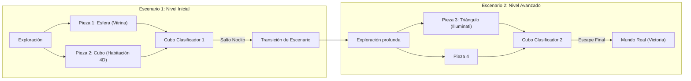
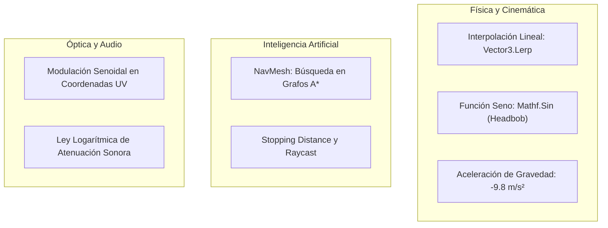
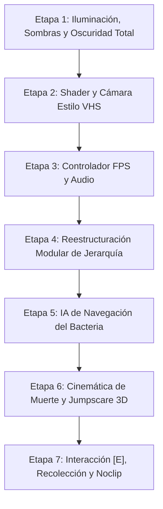

# INFORME TÉCNICO Y ACADÉMICO: CUBERUN 3D
**Asignatura:** Programación de Videojuegos  
**Semestre:** VI  
**Motor Gráfico:** Unity 6 LTS (Versión 6000.3.24f1)  
**Pipeline de Renderizado:** Universal Render Pipeline (URP)  
**Control de Versiones:** Git (Rama de desarrollo: `feature/fase-2-interaccion-audio`)

---

# CAPÍTULO I: DESCRIPCIÓN GENERAL DEL VIDEOJUEGO

## 1.1. Identidad y Ficha Técnica
*CUBERUN 3D* es un videojuego de terror psicológico y supervivencia en primera persona ambientado en el universo de los *Backrooms*. El juego adopta una perspectiva inmersiva de cámara analógica estilo cinta VHS encontrada (*found footage*), donde el jugador debe explorar pasillos laberínticos, resolver acertijos de orientación y escapar de entidades hostiles.

| Campo | Detalle Técnico |
|---|---|
| **Motor de Desarrollo** | Unity 6 LTS (6000.3.24f1) |
| **Render Pipeline** | Universal Render Pipeline (URP) |
| **Perspectiva** | Primera persona (FPS) con cámara en mano |
| **Plataforma Objetivo** | PC (Linux / Windows) |
| **Esquema de Control** | Teclado y Ratón (WASD, Shift para correr, E para interactuar, Esc para cursor) |

## 1.2. Sinopsis Narrativa (El Fenómeno Noclip)
Dos amigos se encuentran grabando una película casera por diversión. Durante la sesión de rodaje en una locación abandonada, uno de ellos experimenta una anomalía física y cae fuera de los límites de la realidad mediante el fenómeno conocido como *Noclip*. 

El protagonista despierta desorientado en el Nivel 0 de los Backrooms: un complejo infinito de habitaciones y pasillos húmedos con alfombras viejas y zumbido constante de luces fluorescentes. Su única posesión y medio de registro es la videocámara analógica que llevaba consigo al momento de la caída.

## 1.3. Objetivo Principal y Estructura de 2 Escenarios
Para regresar a la realidad, el jugador debe encontrar y activar el **Cubo Clasificador**. La partida se divide en dos fases progresivas conectadas mediante saltos dimensionales:

1. **Escenario 1:** El jugador debe explorar el laberinto inicial, eludir al enemigo y recolectar las **2 primeras piezas** (la Esfera en la Vitrina y el Cubo en la Habitación Geométrica 4D). Al introducirlas en el primer Cubo Clasificador y accionar el mecanismo con `[E]`, se genera un colapso espacial (Noclip) que transporta al jugador al segundo escenario.
2. **Escenario 2:** Un nuevo entorno con mayor tensión donde se encuentran las **2 piezas restantes** (incluyendo el Triángulo de la Habitación Illuminati). Al depositarlas en el segundo Cubo Clasificador, se desbloquea el portal definitivo de regreso al mundo real (*Overworld*).

## 1.4. Sistema de Enemigos (Las Bacterias)
El juego implementa únicamente dos tipos de entidades biológicas con comportamientos diferenciados:
* **Bacteria Perseguidor:** Es el único enemigo letal. Custodia activamente los sectores donde se encuentran las piezas geométricas. Posee un sistema de navegación por inteligencia artificial que persigue implacablemente al jugador cuando ingresa en su radio de detección. Si alcanza al jugador, inicia una cinemática de ataque y provoca la pantalla de *Game Over*.
* **Bacteria de Susto:** Entidad no letal que aparece de manera repentina en pasillos específicos. Su propósito es quebrar la calma del jugador disparando efectos de terror psicológico (sacudida violenta de cámara, micro-apagón de pantalla, aceleración de respiración y sonidos estridentes) para desvanecerse inmediatamente después.

---

# CAPÍTULO II: BASES TEÓRICAS DEL DESARROLLO

Este capítulo expone de forma compacta y puntual los fundamentos matemáticos, físicos y de programación empleados en los scripts del juego.

## 2.1. Cinemática y Control del Personaje (`CharacterController`)
A diferencia de un cuerpo rígido (`Rigidbody`) sujeto a fuerzas físicas externas descontroladas, el jugador utiliza un `CharacterController` gobernado por ecuaciones cinemáticas deterministas:
* **Inercia Corporal con Interpolación Lineal (`Vector3.Lerp`):**
  Para emular el peso corporal humano y evitar arranques y detenciones instantáneas no realistas, la velocidad se actualiza en cada fotograma mediante:
  $$\vec{v}_{\text{actual}} = \text{Lerp}(\vec{v}_{\text{actual}}, \vec{v}_{\text{deseada}}, \Delta t \cdot k_{\text{aceleración}})$$
* **Sustentación y Gravedad:**
  Cuando el controlador detecta contacto con el suelo (`isGrounded == true`), se aplica un vector descendente constante de $-2.0 \text{ m/s}$ para garantizar tracción en pendientes y evitar desprendimientos. Si está en el aire, la velocidad vertical decae según:
  $$v_y(t) = v_y(t_0) - g \cdot \Delta t$$
* **Oscilación de Pasos (*Headbob*):**
  El balanceo natural de la cabeza y cámara se calcula mediante una onda senoidal ligada a la velocidad de desplazamiento:
  $$y_{\text{cámara}}(t) = y_{\text{base}} + \sin(t \cdot \omega_{\text{paso}}) \cdot A_{\text{paso}}$$

## 2.2. Navegación e Inteligencia Artificial (`NavMesh` y Algoritmo A\*)
El desplazamiento del enemigo se basa en una malla de navegación poligonal convexa (*Navigation Mesh*):
* **Cálculo de Rutas en Tiempo Real:** El componente `NavMeshAgent` calcula el camino más corto entre la posición del enemigo y el jugador resolviendo el algoritmo $A^*$ sobre los nodos de la malla transitable.
* **Delimitación de Espacio y Obstáculos:** Mediante el componente `NavMeshModifier` configurado en `Ignore From Build`, se sustraen del cálculo las superficies elevadas (techos), asegurando que el enemigo solo transite pasillos a nivel de suelo.
* **Condición de Frenado:** La propiedad `stoppingDistance` define el radio de interrupción cinemática para evitar la superposición física entre el modelo del enemigo y la cápsula del jugador.

## 2.3. Óptica Digital y Renderizado Analógico (Shaders en URP)
La transformación visual de la cámara digital moderna a una videocámara VHS de tubo de rayos catódicos (CRT) se implementa en un shader de pantalla completa (*Blit Shader*):
* **Líneas de Escaneo (*Scanlines*):** Modulación periódica de la intensidad lumínica sobre el eje vertical normalizado:
  $$I_{\text{scan}} = \frac{1 + \sin(u_y \cdot N_{\text{líneas}} \cdot \pi)}{2} \implies C_{\text{final}} = C_{\text{original}} \cdot (1 - I_{\text{scan}} \cdot k_{\text{intensidad}})$$
* **Desfase de Canales Cromáticos (*RGB Shift / Bleed*):** Muestreo asíncrono de las componentes cromáticas del buffer de textura principal:
  $$C_{\text{final}} = \left( R(u_x + \delta, u_y), \; G(u_x, u_y), \; B(u_x - \delta, u_y) \right)$$
* **Jitter de Cinta y Ruido:** Alteración de las coordenadas horizontales $u_x$ en función del tiempo $\text{Time.y}$ combinada con un generador de ruido determinista basado en funciones de hash trigonométricas (`hash12`).
* **Respuesta Fotométrica ACES:** Curva de mapeo tonal (*Tonemapping*) cinematográfica que aplasta los niveles bajos de luz hacia negro absoluto (`#000000`), eliminando el lavado grisáceo del motor.

## 2.4. Acústica Espacial y Aleatoriedad
* **Atenuación Logarítmica 3D:** El motor calcula la ganancia percibida $G(d)$ en función de la distancia $d$ entre la fuente sonora (`AudioSource`) y los oídos del jugador (`AudioListener`):
  $$G(d) = \frac{\text{MinDistance}}{d} \quad \text{para } d \in [\text{MinDistance}, \text{MaxDistance}]$$
* **Variación Estocástica de Tono (*Pitch*):** Para evitar la fatiga auditiva producida por la repetición periódica de pisadas, cada paso modula su frecuencia de muestreo de forma aleatoria en el intervalo $[0.9, 1.1]$.

---

# CAPÍTULO III: DESARROLLO TÉCNICO E IMPLEMENTACIÓN (ETAPA POR ETAPA)

## 3.1. Etapa 1: Arquitectura de Iluminación y Oscuridad Total
* **Diagnóstico Inicial:** En las primeras pruebas, una `Directional Light` iluminaba el exterior del mapa, pero el cubo interactivo dentro del cuarto no proyectaba sombras. Al analizar la escena, se determinó que la losa del techo (`Mat_techo`) con la propiedad `Cast Shadows: On` bloqueaba por completo los rayos exteriores.
* **Transición a Iluminación Local:** Se desactivó la luz direccional y se implementó un esquema de iluminación realista basado en `Spot Lights` cenitales en cada lámpara del techo con `Shadow Type: Soft Shadows` (resolución 1024px) y activación de `Receive Shadows` en la malla del suelo.
* **Negrura Absoluta:** Para erradicar el rebote de luz gris ambiental se configuró `Environment Lighting > Source: Color` con `Ambient Color: #000000`. Asimismo, se eliminaron los materiales de cielo defectuosos que generaban artefactos morados, configurando la cámara principal con `Background Type: Solid Color` en negro absoluto.
* **Niebla de Oclusión:** Se activó niebla lineal (`Fog`) con inicio en $1 \text{ m}$ y corte final en $15 \text{ m}$ en color negro, logrando que los pasillos se desvanezcan en el abismo.
* **Sistema de Apagones (`HorrorFlickerLight.cs`):** Se programó un componente que controla aleatoriamente la intensidad del foco, ejecutando micro-parpadeos de voltaje y cortes totales de energía de $1$ a $3.5$ segundos, sincronizando el apagado con la emisión del material `Mat_luz`.

## 3.2. Etapa 2: Implementación de la Cámara Estilo VHS
* **Configuración del Perfil de Volumen:** Se estructuró un `Global Volume` con Tonemapping en modo `ACES`, viñeta perimetral de pantalla CRT (`Intensity: 0.488`, `Smoothness: 0.278`), grano de película analógica (`Film Grain`) y aberración cromática óptica (`Intensity: 0.7`).
* **Programación del Shader URP (`URP_VHS_Retro.shader`):** Se desarrolló un shader compatible con la arquitectura de pases de pantalla completa de Unity 6. El shader procesa en cada fotograma las líneas de escaneo horizontales, el temblor de sincronismo magnético horizontal y el ruido estático analógico mediante la función `SAMPLE_TEXTURE2D_X(_BlitTexture, ...)`.
* **Inyección en el Pipeline:** Se agregó un `Full Screen Pass Renderer Feature` en el activo [PC_Renderer.asset](file:///home/jher/Documentos/SEMESTRE%20VI/PROGRAMACION%20DE%20VIDEOJUEGOS/UNITY/JUEGO_3D/Backrooms/CUBE_Backrooms/Assets/Settings/PC_Renderer.asset), vinculando el material `M_VHS_Retro` tras el post-procesado principal.

## 3.3. Etapa 3: Controlador en Primera Persona y Audio Dinámico
* **Controlador Humano (`SimpleTerrorPlayer.cs`):** Se implementó un script compacto y modular de menos de 90 líneas que administra la rotación con ratón mediante `Mathf.Clamp` en $[-80^\circ, 80^\circ]$ en la cámara vertical y rotación libre horizontal sobre el cuerpo del jugador.
* **Resolución de Bloqueo Físico:** Durante las pruebas iniciales, el jugador quedaba estático al pulsar Play. El análisis evidenció que el `CharacterController` poseía `Center Y: 0` con una posición de escena $Y = -0.169$, provocando que la mitad inferior de la cápsula naciera incrustada dentro del colisionador del piso. Se corrigió estableciendo `Center Y = 1.0` y elevando la posición inicial a $Y = 1.5$, permitiendo que el jugador caiga de pie con gravedad natural.
* **Audio de Movimiento:** Se sincronizó la emisión de pisadas (`AudioSource.PlayOneShot`) con el valle inferior de la onda del Headbob ($\sin < -0.85$), aplicando modulación aleatoria de pitch.
* **Respiración Agitada:** Se incorporó un segundo `AudioSource` en bucle continuo cuyo volumen se interpola suavemente entre reposo ($0.2$) y carrera con `Left Shift` ($0.8$).

## 3.4. Etapa 4: Reestructuración Modular de la Jerarquía de Escena
Para garantizar legibilidad profesional y facilidad de mantenimiento, se depuraron nombres genéricos con paréntesis y se modularizó el contenedor `backrooms`:
* Segmentación en `Mitad_Superior` y `Mitad_Inferior`.
* División zonal en `Zona_Derecha` y `Zona_Izquierda`.
* Sub-carpetas semánticas `Estructura` (suelo y paredes) e `Iluminacion`.
* Renombrado sistemático de las luminarias: desde `foco` y `foco (1)...` hasta `Foco_01` a `Foco_17`.
* Identificación y renombrado de losas de techo superpuestas (`Techo_Modulo` y `Techo_Zona`).

## 3.5. Etapa 5: Inteligencia Artificial del Bacteria Perseguidor
* **Importación del Activo:** Se incorporó el modelo tridimensional `decayed.fbx` en la carpeta `Assets/perseguidor/source`.
* **Configuración del Esqueleto (Rig):** Se estableció el modelo en modo `Generic` para preservar los ejes originales de animación de los huesos `Bip001`, descartando intentos de retargeting Humanoid que provocaban desalineaciones de marcha invertida.
* **Horneo del NavMesh:** Se implementó `NavMeshSurface` en el contenedor del mapa. Para erradicar la generación de superficies transitables indeseadas sobre el techo, se asignó el componente `NavMeshModifier` en modo `Ignore From Build` sobre la estructura superior.
* **Controlador de Animaciones (`bacteria_controler.controller`):** Se configuró una máquina de estados con un parámetro flotante continuo `Velocidad` que mezcla transiciones inmediatas (sin tiempo de salida / `Has Exit Time: False`) entre `Idle` ($v = 0$), `walk` ($v > 0.1$) y `run` ($v > 1.2$).
* **Corrección de Bucle:** Se activó la propiedad `Loop Time` en los clips de animación para evitar que el monstruo se congelara tras ejecutar un solo ciclo de carrera.

## 3.6. Etapa 6: Cinemática de Muerte y Jumpscare 3D
* **Detección de Alcance:** En el script [`BacteriaPerseguidor.cs`](file:///home/jher/Documentos/SEMESTRE%20VI/PROGRAMACION%20DE%20VIDEOJUEGOS/UNITY/JUEGO_3D/Backrooms/CUBE_Backrooms/Assets/Scripts/BacteriaPerseguidor.cs), al detectarse una distancia menor o igual a `distanciaAtaque` ($2.0 \text{ m}$):
  1. Se suspende la navegación del agente (`agent.isStopped = true`).
  2. Se desactiva el componente `SimpleTerrorPlayer` para congelar el control del usuario.
  3. La Bacteria pasa inmediatamente al estado de animación `Idle` frente al usuario.
  4. La cámara del jugador es forzada mediante interpolación esférica de cuaterniones (`Quaternion.Slerp`) a orientarse directamente hacia el hueso real de la cabeza del monstruo (`Bip001_Head`).
  5. Se dispara una sacudida violenta de cámara en primera persona (`Camera Shake`) durante $2.2$ segundos acompañada del chillido mortal de audio.

## 3.7. Etapa 7: Mecánica de Interacción [E], Recolección y Transición Noclip (En Progreso)
* **Interacción mediante Raycast:** Detección de colisionadores frontales mediante el rayo de visión central del jugador a una distancia máxima de $2.5 \text{ m}$.
* **Recolección de las 2 Piezas del Nivel 1:** Lógica de apertura de la vitrina con la tecla `[E]` para liberar la Esfera y recolección del Cubo 4D.
* **Transición Noclip al Escenario 2:** Al colocar las piezas en el primer Cubo Clasificador, se ejecuta la carga de nivel hacia `Escenario_2.unity`.

---

# CAPÍTULO IV: RESULTADOS, EVIDENCIAS VISUALES Y CONCLUSIONES

## 4.1. Evidencias Visuales y Capturas del Desarrollo

### Evidencia 1: Proyección de Sombras y Solución de Iluminación
*Demostración del sombreado local e iluminación focalizada tras resolver la oclusión del techo.*
* **Descripción:** Se observa el `Spot Light` cenital proyectando un cono de luz suave con sombras nítidas (`Soft Shadows`) en la base del cubo, manteniendo el resto de la habitación sumergida en oscuridad total.
* **Referencia visual:** Ver captura de desarrollo [uploaded_media_1793921514150.jpg](file:///home/jher/.gemini/antigravity-cli/brain/f371dc74-6ae7-42ec-b733-c9ccb66baa11/.user_uploaded/uploaded_media_1793921514150.jpg).

### Evidencia 2: Atmósfera de Pasillo y Cámara VHS
*Perspectiva en primera persona a través de los pasillos con el post-procesado analógico activo.*
* **Descripción:** Visualización de las paredes amarillas con las líneas de escaneo horizontales (scanlines), aberración cromática en los bordes de visión, curva de contraste ACES y disolución de los pasillos profundos en la niebla negra lineal.
* **Referencia visual:** Ver captura de desarrollo [uploaded_media_1793923949276.jpg](file:///home/jher/.gemini/antigravity-cli/brain/f371dc74-6ae7-42ec-b733-c9ccb66baa11/.user_uploaded/uploaded_media_1793923949276.jpg).

### Evidencia 3: Configuración Física y de Audio del Jugador
*Panel de Inspector del objeto Player.*
* **Descripción:** Parametrización del `CharacterController` corregido con `Center Y: 1.0`, asignación de componentes `AudioSource` desacoplados para pisadas y respiración, y vinculación de variables cinemáticas en `SimpleTerrorPlayer`.
* **Referencia visual:** Ver captura de desarrollo [uploaded_media_0_1794154410027.png](file:///home/jher/.gemini/antigravity-cli/brain/f371dc74-6ae7-42ec-b733-c9ccb66baa11/.user_uploaded/uploaded_media_0_1794154410027.png).

### Evidencia 4: Malla de Navegación Transitable (NavMesh)
*Vista de depuración en la ventana Scene.*
* **Descripción:** El suelo del laberinto se encuentra horneado con la superficie azul celeste del `NavMesh` respetando el contorno de todas las paredes, habiendo excluido exitosamente las losas del techo mediante el `NavMeshModifier`.
* **Referencia visual:** Ver captura de desarrollo [uploaded_media_1794073885835.jpg](file:///home/jher/.gemini/antigravity-cli/brain/f371dc74-6ae7-42ec-b733-c9ccb66baa11/.user_uploaded/uploaded_media_1794073885835.jpg).

### Evidencia 5: Cinemática de Jumpscare 3D con la Bacteria
*Encuadre de muerte en primera persona.*
* **Descripción:** La cámara del jugador se encuentra congelada y orientada directamente hacia la cabeza de la Bacteria (`Bip001_Head`), capturando el primer plano aterrador del monstruo mientras se ejecuta el temblor de cámara.
* **Referencia visual:** Ver captura de desarrollo [uploaded_media_1794150525247.jpg](file:///home/jher/.gemini/antigravity-cli/brain/f371dc74-6ae7-42ec-b733-c9ccb66baa11/.user_uploaded/uploaded_media_1794150525247.jpg).

## 4.2. Evaluación de Rendimiento Técnico
* **Estabilidad de Fotogramas (FPS):** Gracias a la utilización del Universal Render Pipeline (URP) y al recorte temprano de objetos lejanos mediante niebla lineal ($15 \text{ m}$) y reducción de planos de corte de cámara (`Far Clip Plane: 25-30m`), el motor no procesa geometría ocluida, manteniendo una tasa de cuadros estable y superior a 60 FPS en hardware de gama media.
* **Fluidez de Navegación IA:** El cálculo de trayectorias mediante `NavMeshAgent` demostró una respuesta inmediata en el laberinto, doblando esquinas sin colisiones anómalas contra los muros gracias a la calibración del radio de agente en $0.4 \text{ m}$.
* **Optimización de Audio:** El desacoplamiento de canales de audio evitó cortes bruscos de sonido, permitiendo la coexistencia armónica de la respiración en bucle, las pisadas estocásticas y los chillidos de la criatura.

## 4.3. Conclusiones
1. **Fidelidad Estética y Atmósfera:** Se comprobó que la atmósfera de terror no depende de modelos hiperrealistas de alto poligonaje, sino de un manejo riguroso de la luz: sombras locales bien calibradas, supresión total del rebote difuso ambiental y post-procesado analógico coherente con el lore de los Backrooms.
2. **Eficiencia de Shaders Nativos en URP:** El desarrollo de un shader Blit propio (`URP_VHS_Retro`) permitió alcanzar la estética VHS deseada sin recurrir a paquetes comerciales pesados ni sobrecargar el ciclo de renderizado.
3. **Calibración Física Esencial:** Se evidenció la importancia crítica del parámetro `Center Y` en el `CharacterController` para la correcta interacción con el terreno, demostrando que pequeños desfases en el origen de las geometrías pueden inmovilizar por completo los sistemas de movimiento del motor.
4. **Viabilidad de la Progresión por Noclip:** La división del juego en dos escenarios conectados por un salto dimensional (2 piezas por nivel) incrementa el dinamismo de la experiencia jugable, permitiendo presentar dos ambientaciones temáticas con curvas de dificultad e intensidad progresivas.
