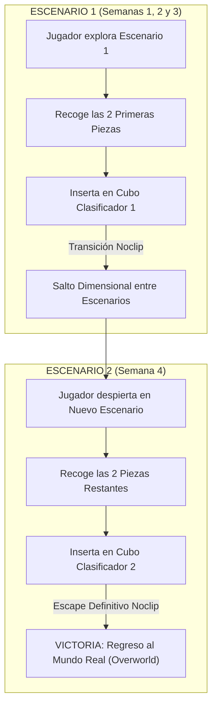

# Plan de Trabajo (4 Semanas) – Proyecto CUBERUN 3D

## Resumen del Proyecto y Dinámica de Juego
**CUBERUN** es un videojuego de terror y supervivencia en primera persona ambientado en los Backrooms con estética analógica VHS desarrollado en **Unity 6 LTS** bajo **Universal Render Pipeline (URP)**.

El flujo principal se divide en **2 Escenarios Progresivos conectados mediante Noclip**:

---

## Cronograma Detallado de 4 Semanas

### Semana 1: Atmósfera de Terror, Iluminación, Cámara VHS y Apagones (COMPLETADA 100%)
* **Iluminación Interior y Sombras:** Diagnóstico de oclusión de la `Directional Light` por el techo; activación de `Soft Shadows` en los `Spot Lights` locales y habilitación de `Receive Shadows` en el suelo.
* **Oscuridad Total:** Configuración de `Environment Lighting` en color negro puro `(0,0,0)`, supresión de skybox incompatible y `Camera Clear Flags: Solid Color (#000000)`.
* **Niebla Lineal (Fog):** Rango de `1m` a `15m` en color negro para perder pasillos lejanos en oscuridad.
* **Cámara Analógica VHS:** `Volume Profile` (Tonemapping ACES, viñeta, aberración cromática, grano) + shader personalizado URP Blit (`URP_VHS_Retro.shader`) con scanlines, jitter horizontal de cinta y estática.
* **Apagones Eléctricos:** Script `HorrorFlickerLight.cs` con micro-parpadeos erráticos, apagones totales y sincronización con el material emisivo del foco.

---

### Semana 2: Jugador FPS, Audio Dinámico, IA Bacteria y Muerte 3D (COMPLETADA 100%)
* **Controlador en Primera Persona:** Script `SimpleTerrorPlayer.cs` con inercia corporal (`Vector3.Lerp`), carrera con `Left Shift`, física corregida de `CharacterController` (`Center Y = 1`) y bloqueo de cursor (`Esc`).
* **Audio de Pisadas y Respiración:** Sonido de pasos sincronizado al balanceo senoidal (`Headbob`) con variación de tono (`pitch`), y respiración reactiva que aumenta de volumen al correr.
* **Audio Espacial 3D:** Script `SonidoAleatorio3D.cs` para ruidos ambientales intermitentes con decaimiento logarítmico.
* **IA Bacteria Perseguidor con NavMesh:** Script `BacteriaPerseguidor.cs` con navegación en suelo limpio (techo excluido con `NavMesh Modifier`), detección por proximidad y animación de persecución `Run`.
* **Muerte Cinematográfica 3D:** Al atrapar al jugador, la Bacteria frena en seco en `Idle` frente a él, la cámara del jugador se congela, enfoca automáticamente a su cabeza (`Bip001_Head`), tiembla en primer plano y reproduce el grito mortal.

---

### Semana 3: Interacción [E], 2 Primeras Piezas, Cubo 1, Salto Noclip y Game Over (EN DESARROLLO)
* **Sistema de Interacción con tecla [E] (`PlayerInteraction.cs`):**
  * Raycast desde la cámara con interfaz `IInteractuable` y aviso en pantalla cuando hay un objeto interactivo en la mira.
* **Mecánica de Recolección en Escenario 1 (2 Piezas):**
  * **Pieza 1 (Esfera en Vitrina):** Vitrina cúbica interactuable con [E]; al pulsar [E], se abre la vitrina y la esfera cae al suelo para ser recogida.
  * **Pieza 2 (Cubo 4D / Teseracto):** Habitación geométrica con cubos de diversos tamaños donde el cubo principal interactuable destaca con material de teseracto.
* **Cubo Clasificador 1 y Transición Noclip:**
  * Al introducir las 2 piezas en el `Cube_clasificador` del Escenario 1 y presionar [E], se dispara una distorsión visual y sonora de Noclip que carga el **Escenario 2** (`SceneManager.LoadScene("Escenario_2")`).
* **Sistema de Derrota Completo (Pantalla GAME OVER):**
  * Al finalizar la cinemática de muerte de la Bacteria, activar panel Canvas de Game Over.
  * Botón **Reintentar:** Reinicia la escena en la que murió el jugador.
  * Botón **Salir:** Cierra el juego (`Application.Quit`).
  * Desbloqueo y visibilidad del cursor del ratón.

---

### Semana 4: Nuevo Escenario 2, 2 Piezas Finales, Cubo 2, Escape al Mundo Real, Bacteria Susto y Pulido
* **Construcción del Nuevo Escenario 2:**
  * Creación de la nueva escena `Escenario_2.unity` con ambientación diferenciada (nuevas texturas, pasillos más estrechos u oscuros).
  * Horneo de `NavMesh` propio y colocación del Bacteria Perseguidor en el nuevo entorno.
* **Las 2 Piezas Restantes y Cubo Clasificador 2:**
  * **Pieza 3 (Triángulo en Habitación Illuminati):** Decoración piramidal con símbolos en paredes y triángulo coleccionable.
  * **Pieza 4:** Cuarta figura geométrica en una zona oculta del Escenario 2.
  * **Cubo Clasificador 2:** Al insertar las 2 piezas finales, se activa el mecanismo de salida definitivo.
  * Transición de Noclip final hacia la **Pantalla de Victoria** (el jugador regresa al mundo real / Overworld).
* **Entidad 2: Bacteria de Susto (`BacteriaSusto.cs`):**
  * Apariciones sorpresa en pasillos que provocan sobresalto psicológico sin matar (sacudida súbita de cámara, corte momentáneo de audio, aumento brusco de respiración y desaparición del monstruo).
* **Diseño Sonoro y Señalética:**
  * Pistas y símbolos geométricos en las paredes de ambos escenarios.
  * Música ambiental de fondo en bucle y zumbidos de lámparas.
* **Optimización y Build Final:**
  * Ajustes de balance en la velocidad del monstruo y pruebas de la transición entre Escenario 1 y Escenario 2.
  * Generación de la Build ejecutable final del juego para PC.

---

## Matriz Resumen de las 4 Semanas

| Semana | Eje Principal | Escenario | Estado | Entregables Clave |
|---|---|---|---|---|
| **Semana 1** | Iluminación, Sombras y Cámara VHS | Escenario 1 | **Completada (100%)** | Soft Shadows, niebla negra, shader analógico VHS, script `HorrorFlickerLight.cs`. |
| **Semana 2** | Jugador FPS, Audio y Bacteria IA | Escenario 1 | **Completada (100%)** | `SimpleTerrorPlayer.cs`, audio pasos/respiración, NavMesh, `BacteriaPerseguidor.cs`, jumpscare 3D. |
| **Semana 3** | Interacción [E], 2 Piezas, Cubo 1 y Game Over | Escenario 1 | **En Desarrollo** | `PlayerInteraction.cs`, Vitrina (Esfera), Cubo 4D, Cubo Clasificador 1 con salto Noclip, menú Game Over. |
| **Semana 4** | Nuevo Escenario 2, 2 Piezas Finales, Victoria y Pulido | Escenario 2 | **Pendiente** | `Escenario_2.unity`, Pieza 3 (Triángulo) y Pieza 4, Cubo Clasificador 2, escape al Overworld, Bacteria de Susto y Build final. |
